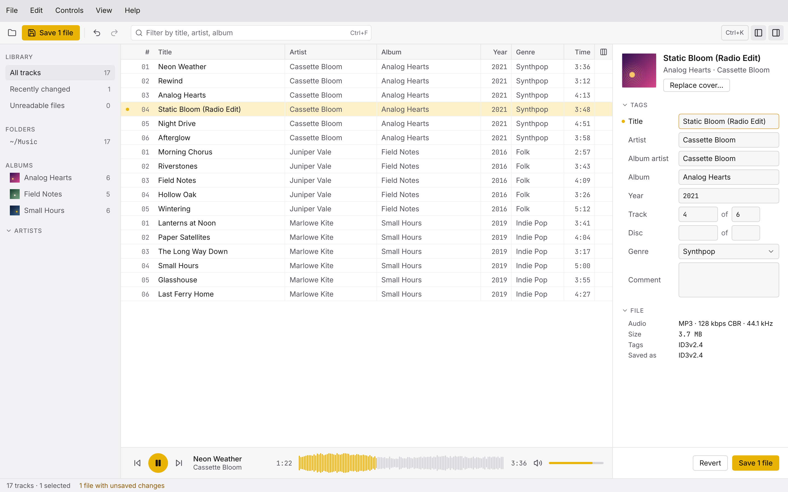
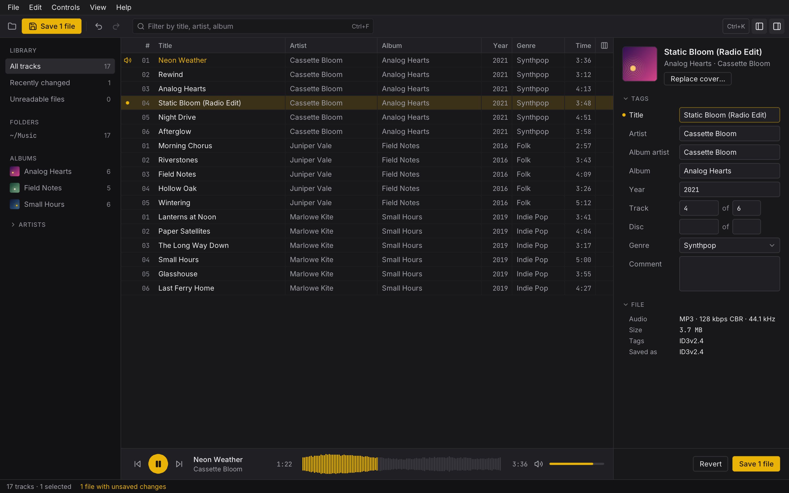

<p align="center">
  
</p>

<h1 align="center">Colophon</h1>

<p align="center">
  A desktop MP3 tag editor for macOS, Windows and Linux.
  <br />
  <a href="https://openmediastack.github.io/colophon/">openmediastack.github.io/colophon</a>
</p>

<p align="center">
  
  
  
</p>

---

## Overview

Colophon reads and writes the tags of MP3 files: title, artist, album, track and disc numbers,
year, genre, comment and cover art. Open a folder or a few files, browse them by album, artist or
folder, edit one track or a whole album at once, and save when you are ready: nothing touches your
files before that.

It reads and writes ID3v2.2, ID3v2.3, ID3v2.4, ID3v1.0 and ID3v1.1, and reads APE tags, which it
leaves as they are.

<p align="center">
  
  
</p>

---

## Features

- **Library**: open folders and files, or drop them on the window. The sidebar lists the folders,
  albums and artists, every track, the recently changed ones and the files that could not be read.
- **Table**: sort by any column, filter by title, artist or album, and show, hide, resize and
  reorder the columns.
- **Editing**: in the inspector or right in the table, one track or many at once, where values the
  tracks do not share say so. Number the tracks of an album in one go, select a whole album, undo
  and redo every change.
- **Cover art**: replace it with an image picked or dropped on the window, extract it to a file,
  or remove it.
- **Saving**: changes wait, marked track by track, until you save them, and quitting asks what to
  do with them.
- **Warnings**: a track without a number in a numbered album, an album artist unlike the rest of
  its album, a value an ID3v1 tag cannot hold whole.
- **Tag versions**: write ID3v2.4 or ID3v2.3 by default, and keep, always write or never write
  ID3v1. Developer mode chooses the versions file by file and shows every frame, with the text
  encoding, padding and unsynchronisation of what is saved.
- **Player**: listen to a track before tagging it, and seek in its waveform.
- **Command palette**: every command by name, with <kbd>Ctrl</kbd>+<kbd>K</kbd>
  (<kbd>⌘</kbd>+<kbd>K</kbd> on macOS), and the keyboard shortcuts of each platform.
- **Light and dark themes**, following the system, in **English and French**.

---

## Install

Download the latest version from the
[releases page](https://github.com/OpenMediaStack/colophon/releases/latest):

| Platform | File |
|---|---|
| macOS, Apple silicon and Intel | `Colophon-<version>.dmg` |
| Windows 10 and 11, x64 | `Colophon-<version>-setup.exe` |
| Linux, x86_64 | `Colophon-<version>-x86_64.AppImage` |

**macOS**: open the disk image and drag Colophon to Applications. The app is not signed with an
Apple Developer ID, so the first time macOS says it could not verify Colophon and only offers
**Done** or **Move to Trash**: click **Done**, then either

- go to **System Settings → Privacy & Security**, scroll down to **Security**, click
  **Open Anyway** next to the line about Colophon (it shows for about an hour after the attempt),
  confirm with your password or Touch ID, and open Colophon again;
- or lift the quarantine macOS put on the downloaded app, from the Terminal:

  ```bash
  xattr -dr com.apple.quarantine /Applications/Colophon.app
  ```

Either way, macOS remembers it, and Colophon then opens like any other app.

**Windows**: run the installer. SmartScreen may warn about an unknown publisher: click
**More info**, then **Run anyway**.

**Linux**: make the AppImage executable, then run it:

```bash
chmod +x Colophon-*-x86_64.AppImage
./Colophon-*-x86_64.AppImage
```

Some distributions need FUSE 2 for AppImages (`libfuse2` on Debian and Ubuntu).

---

## Development

This branch, `odin-migration`, rebuilds Colophon 1.0.0 in [Odin](https://odin-lang.org) with
SDL3. The plan and its progress are in [`docs/odin-migration.md`](docs/odin-migration.md), and how
the work runs is in [`AGENTS.md`](AGENTS.md).

### Prerequisites

- Odin `dev-2026-10`
- SDL3 3.4: `brew install sdl3` on macOS; on Windows, Odin ships it; on Linux, your
  distribution's `libsdl3-dev` or a build from source, found through `SDL3_LIB_DIR` when it is not
  in the system's library folders
- Odin's own libraries for sound and text, which its release ships built on Windows and
  macOS; on Linux, build them once from Odin's folder: `sh "$(odin root)/vendor/stb/src/build_stb.sh" unix`
  and `sh "$(odin root)/vendor/miniaudio/src/build_miniaudio.sh"`
- `odinfmt`, built from [OLS](https://github.com/DanielGavin/ols) (`tools/odinfmt`), for
  `scripts/check.sh` to check the formatting
- The [odid3](https://github.com/OpenMediaStack/odid3) submodule:

  ```bash
  git submodule update --init
  ```

### Run and test

```bash
./scripts/build.sh && ./build/colophon   # Build and start the app
./scripts/test.sh                        # Every test, the interface's captures included
./scripts/check.sh                       # What the CI checks: vet, strict style, formatting
```

### Layout

| Folder | What it holds |
|---|---|
| `src/app` | The application: the window, the event loop and the screens |
| `src/engine` | The application state and every command |
| `src/library` | Finding the audio files of a folder, reading and saving them |
| `src/mpa` | The MPEG audio properties: duration, bitrate, sample rate, channels |
| `src/audio` | Playing and decoding sound with miniaudio, and the waveform of a track |
| `src/ui` | The toolkit the interface is drawn with: widgets, text, the table, menus, dialogs |
| `libs/odid3` | [odid3](https://github.com/OpenMediaStack/odid3), which reads and writes the ID3 tags |

The platform package, for what differs from one system to the next, arrives with its slice of
the plan.

---

## License

MIT. Colophon ships open-source fonts, icons and libraries under their own licenses, listed in its
About dialog.
